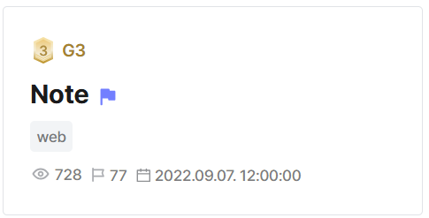

## Note  

`format()` only sanitises the expected number of args of the sqlite query --> additional args are interpolated verbatim but cannot contain `"\` --> sqli by passing 3rd url param into `/login`  

ejs template injection rce in `/preview`  

Flag: `BISC{802909969e73b0ef2974887b43d4852bf81c681145b080ee78db2478cbf2fc44}`