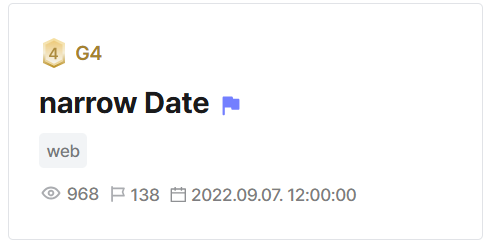

## narrow Date  

/home.php displays all matching records from search query without redaction  

accounts are added in chronological order by `regdate` in `dump.sql` --> admin accounts are added between the timestamps of guest3 and guest4  

email field has more lenient blacklist --> use `TIMESTAMP` keyword to bruteforce `regdate` and get admin account regdates  

Flag: `BISC{85b889e122faf58a2ddcbd88ef23a5e72818ba33d9bb7203130f65f5f5ea0e44}`